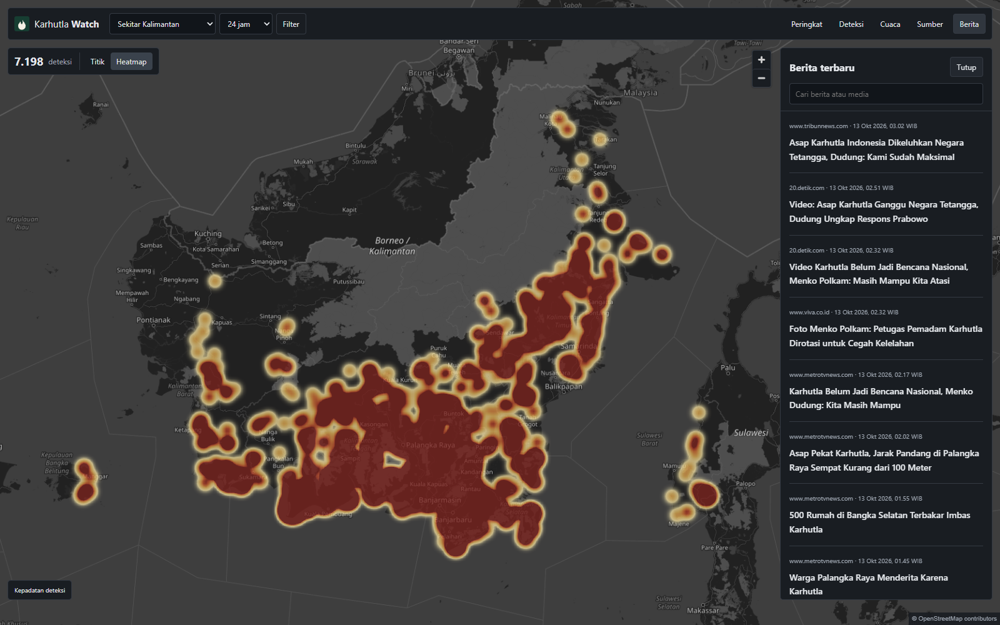

# Karhutla Watch

Peta interaktif titik panas Indonesia, peringkat provinsi, kualitas udara, berita karhutla, dan prakiraan cuaca dalam satu tampilan.

[Buka Karhutla Watch](https://karhutla.my.id)

[](https://github.com/ramaikn/karhutla-watch/actions/workflows/ci.yml)
[](LICENSE)



## Fitur

- **Peta penuh, dark mode.** Deteksi satelit NASA FIRMS VIIRS dengan tampilan titik, kelompok, atau heatmap kepadatan.
- **Peringkat wilayah.** 38 provinsi diurutkan berdasarkan jumlah deteksi. Kolom tambahan menunjukkan keyakinan tinggi dan daya radiasi api maksimum (FRP, MW). Klik provinsi untuk memusatkan peta.
- **Kualitas udara.** Tabel PM2.5 dan PM10 dari model CAMS Global melalui Open-Meteo pada satu lokasi acuan per provinsi, diurutkan berdasarkan PM2.5 tertinggi.
- **Berita dari 25 media.** Setiap media memakai pencarian, rentang waktu, dan batas hasil yang sama. Artikel terbaru tampil paling atas, dengan pencarian judul atau penerbit.
- **Cuaca seluruh Indonesia.** Cari di antara 83.762 desa/kelurahan pada 38 provinsi, lalu buka prakiraan resmi BMKG untuk lokasi pilihan.
- **Filter dan ekspor.** Rentang 24 jam, 3 hari, atau 7 hari; wilayah, keyakinan, dan satelit; daftar deteksi, tren, serta unduhan CSV.
- **Responsif.** Desktop memiliki panel detail di kiri dan berita di kanan. Pada ponsel, tab mengganti satu panel di bawah peta tanpa menutup peta. Dialog About tersedia di kedua versi.
- **Tanpa API AI berbayar.** Web dapat dihosting statis. Collector memperbarui snapshot secara terpisah.

## Jalankan lokal

Memerlukan [Bun](https://bun.sh/) versi 1.3 atau lebih baru.

```sh
git clone https://github.com/ramaikn/karhutla-watch.git
cd karhutla-watch
bun install --frozen-lockfile --backend hardlink
bun run dev:web
```

Buka alamat yang dicetak Vite, biasanya `http://127.0.0.1:5173`. Snapshot publik disertakan sehingga kamu bisa mencoba antarmuka tanpa kunci API.

Untuk menjalankan web sekaligus pembaruan sumber saat mulai dan setiap 30 menit:

```sh
bun run dev
```

Kunci NASA opsional. Jika diperlukan, salin `.env.example` menjadi `.env`, lalu isi `FIRMS_MAP_KEY`. Tanpa kunci, collector menggunakan CSV publik resmi NASA. Jangan mengunggah `.env` atau menaruh rahasia pada variabel `VITE_*`.

## Perintah

| Perintah | Fungsi |
| --- | --- |
| `bun run dev:web` | Web lokal tanpa collector |
| `bun run dev` | Web dan collector berkala |
| `bun run collect` | Perbarui deteksi, berita, cuaca cadangan, dan udara |
| `bun run collect:news` | Perbarui berita saja |
| `bun run prepare:data` | Hitung ulang ranking dan berita siap tampil dari snapshot lokal |
| `bun run collect:air` | Perbarui kualitas udara saja |
| `bun test` | Pengujian alur penting |
| `bun run build` | Periksa TypeScript dan buat build produksi |
| `bun run preview` | Buka build produksi secara lokal |

Indeks wilayah dan geometri provinsi sudah disertakan. `bun run prepare:locations` dan `bun run prepare:provinces` hanya diperlukan untuk membuat ulang data tersebut dari revisi sumber yang dipatok.

## Sumber dan cara membaca data

| Data | Sumber | Ukuran yang ditampilkan |
| --- | --- | --- |
| Titik panas | [NASA FIRMS](https://firms.modaps.eosdis.nasa.gov/) | Deteksi VIIRS NOAA-20, NOAA-21, dan S-NPP |
| Peringkat provinsi | FIRMS dan [wilayah_boundaries](https://github.com/cahyadsn/wilayah_boundaries) | Jumlah deteksi, keyakinan tinggi, FRP maksimum |
| Udara | [CAMS / Open-Meteo](https://open-meteo.com/en/docs/air-quality-api) | Konsentrasi model PM2.5 dan PM10, µg/m³ |
| Cuaca | [BMKG](https://data.bmkg.go.id/prakiraan-cuaca/) | Prakiraan desa/kelurahan sesuai kode `adm4` |
| Nama wilayah | [cahyadsn/wilayah](https://github.com/cahyadsn/wilayah) | Kode Kemendagri, bukan kode BPS |
| Berita | Google News RSS per penerbit | Judul, penerbit, waktu terbit dari RSS, dan tautan |
| Peta dasar | [OpenStreetMap](https://www.openstreetmap.org/copyright) | Tile raster dengan penyesuaian gelap |

**Peringkat bukan skor bahaya.** Deteksi berulang dari lintasan/satelit berbeda tetap dihitung sebagai deteksi, bukan kebakaran berbeda. FRP adalah daya radiasi, bukan suhu. Heatmap menunjukkan kepadatan deteksi, bukan luas terbakar. Awan, asap, jeda pengamatan, dan data yang belum diperbarui dapat memengaruhi hasil.

**Udara adalah keluaran model, bukan sensor lapangan.** Satu titik acuan tidak mewakili rata-rata atau kondisi terburuk seluruh provinsi. Peringkat udara terpisah dari filter waktu deteksi. Waktu data tersedia agar snapshot lama tidak dianggap pengukuran saat ini. Detail cakupan, retensi, dan lisensi tersedia di [metode data](docs/DATA.md).

Proyek ini bukan layanan tanggap darurat. Untuk informasi resmi, gunakan [BMKG](https://www.bmkg.go.id/cuaca/karhutla), [BNPB](https://www.bnpb.go.id/berita), dan [SiPongi](https://sipongi.gakkum.kehutanan.go.id/).

## Deployment

Build menghasilkan folder `dist` yang dihosting dengan Cloudflare Workers Static Assets. Worker Cloudflare penjadwal terpisah memicu GitHub Actions setiap 30 menit; antrean Actions tetap berlaku. Penjadwal memerlukan token khusus sebagai Cloudflare Secret `GITHUB_ACTIONS_TOKEN`. Jadwal GitHub menjadi cadangan sampai repository variable `CLOUDFLARE_CRON_ENABLED=true` dipasang setelah secret Cloudflare siap. Kunci NASA opsional disimpan sebagai Actions secret, bukan file publik. Lihat [panduan deployment](docs/DEPLOY.md) dan [pengaturan Cloudflare Cron](docs/CRON.md).

Collector menyiapkan 36 kombinasi filter ranking dan berkas berita terpisah. Browser memuat keduanya paralel dengan data peta, kemudian memeriksa pembaruan setiap menit tanpa mengosongkan data yang sudah tampil. Perhitungan batas provinsi tidak lagi dilakukan di perangkat pengguna.

API gratis Open-Meteo ditujukan untuk penggunaan nonkomersial. Penggunaan komersial perlu memeriksa paket dan ketentuan sumber walaupun kode aplikasi berlisensi Apache-2.0.

## Kontribusi

Bug dan usulan dapat dikirim lewat [Issues](https://github.com/ramaikn/karhutla-watch/issues). Baca [CONTRIBUTING.md](CONTRIBUTING.md), [tata krama komunitas](CODE_OF_CONDUCT.md), serta [SECURITY.md](SECURITY.md) untuk laporan keamanan.

Peta kode dan alur data tersedia di [arsitektur](docs/ARCHITECTURE.md).

## Lisensi dan atribusi

Kode tersedia di bawah [Apache License 2.0](LICENSE). Saat mendistribusikan fork atau proyek turunan, sertakan lisensi dan atribusi pihak ketiga yang relevan dalam [NOTICE](NOTICE).

Lisensi kode tidak menggantikan lisensi data dan dependensi. Atribusi NASA, BMKG, OpenStreetMap, CAMS/Open-Meteo, dan kontributor data wilayah tetap berlaku.
